# PickMate

个性化购物决策助手：对话式帮用户比价、澄清偏好、给出可解释的选购建议。

## 界面预览

<table>
  <tr>
    <td>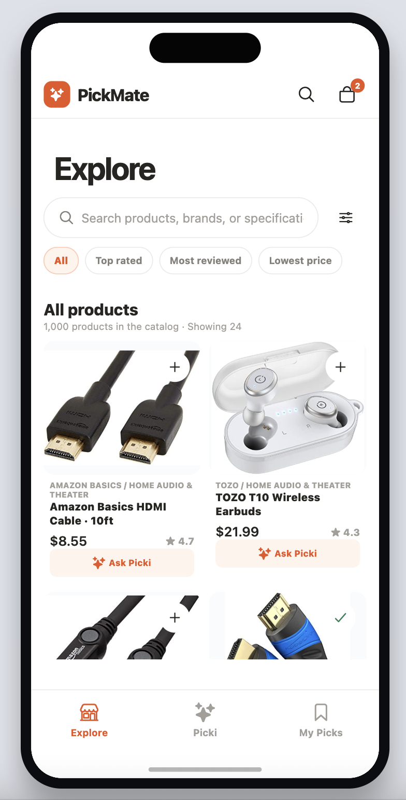</td>
    <td>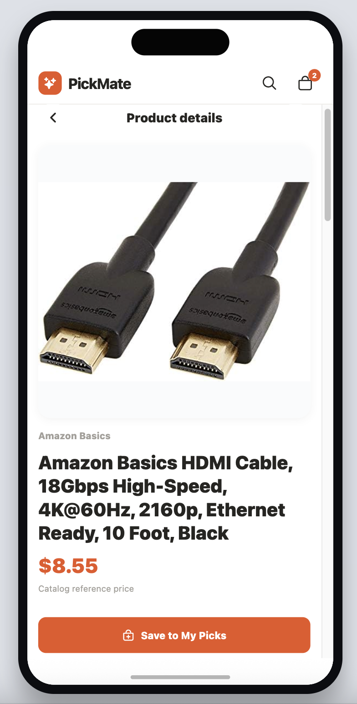</td>
    <td>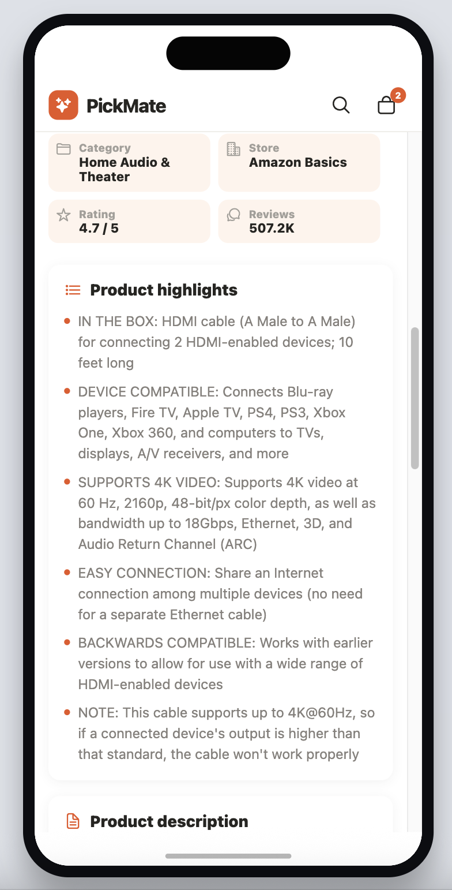</td>
    <td>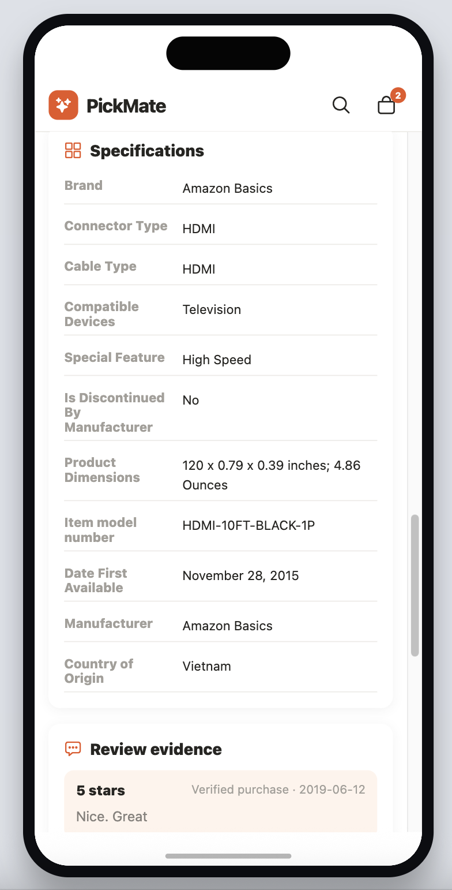</td>
  </tr>
  <tr>
    <td>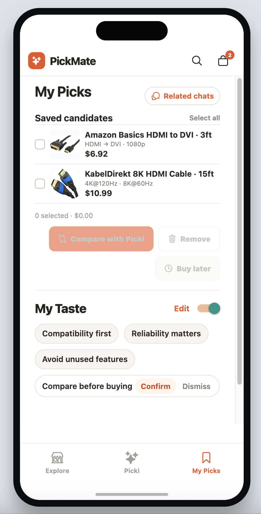</td>
    <td>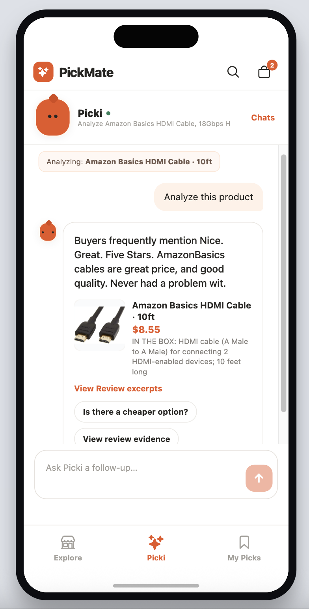</td>
    <td>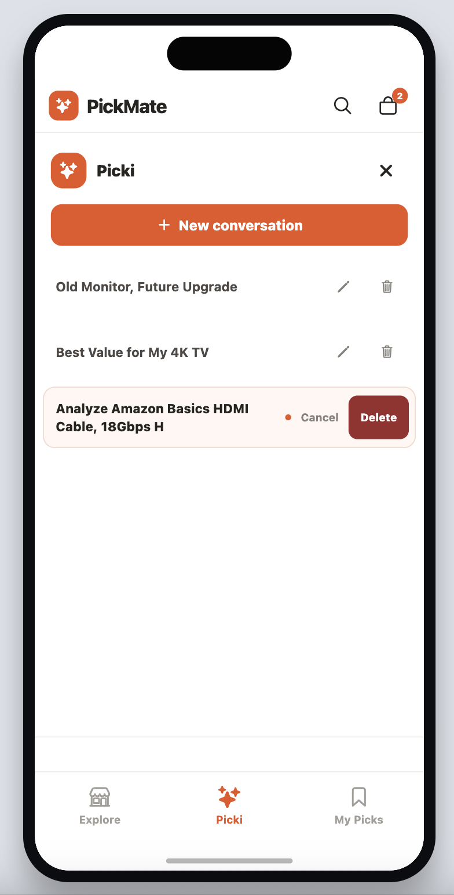</td>
    <td>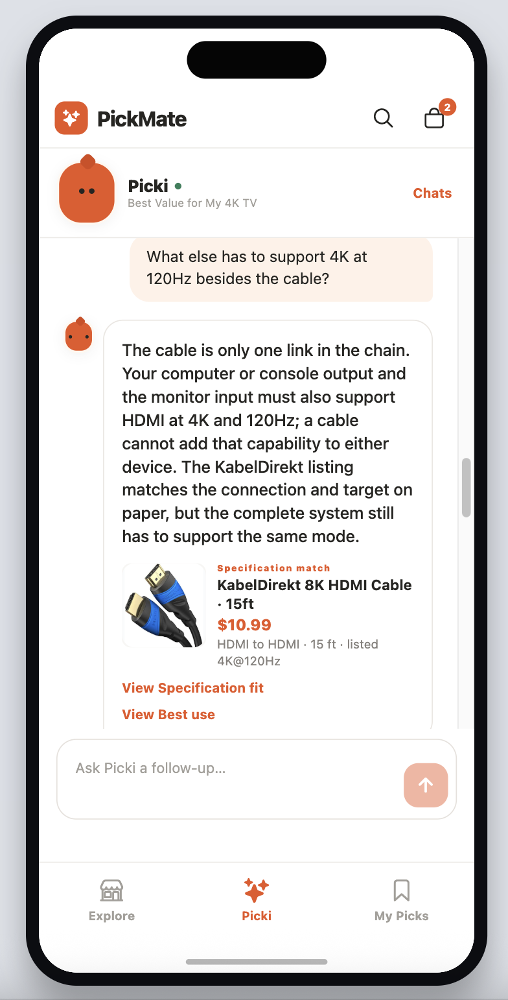</td>
  </tr>
  <tr>
    <td>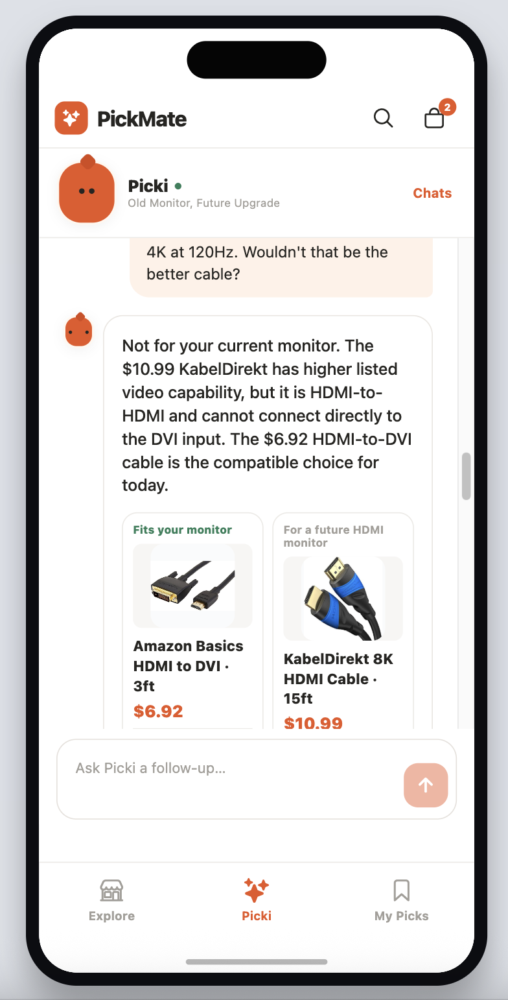</td>
    <td>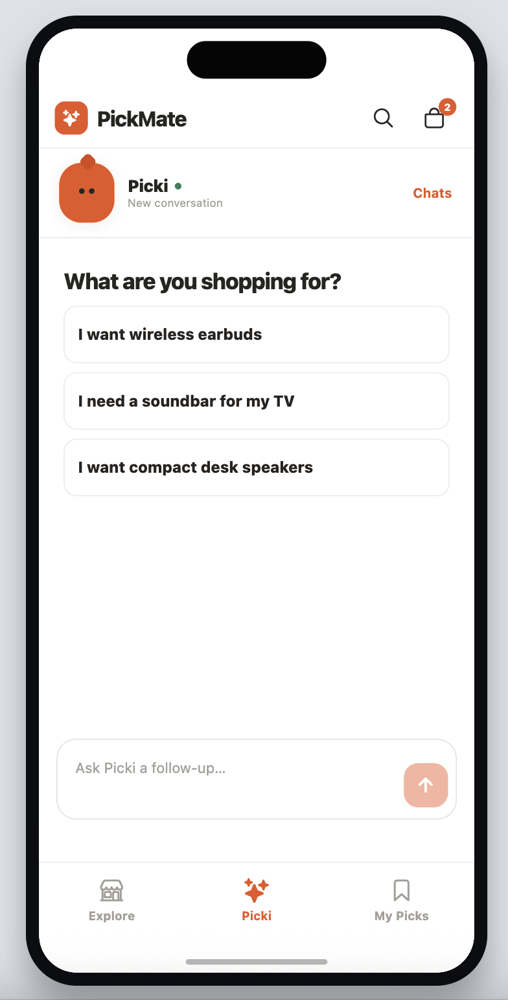</td>
    <td>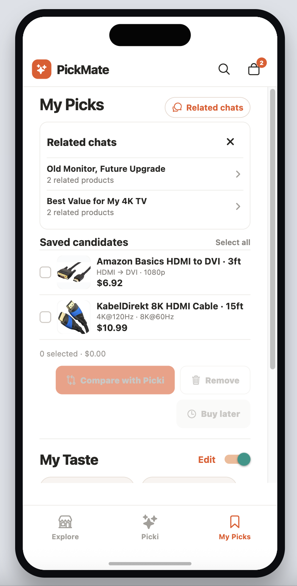</td>
    <td>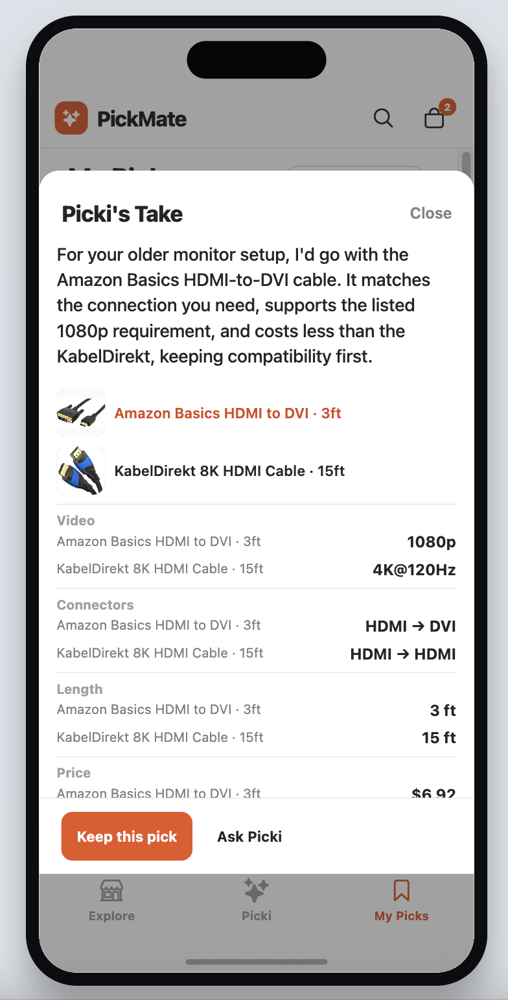</td>
  </tr>
</table>

## 数据集

产品展示基于 [EComAgentBench](https://github.com/Morizeyao/EComAgentBench_) 的商品库（[EcomAgentBenchProductDB](https://huggingface.co/datasets/ecomagentbench/EcomAgentBenchProductDB)，源自 Amazon Reviews 2023）。演示目录取其中 **Home Audio & Theater** 类目的约 **1000** 个有图、有价商品（soundbar / speaker / receiver 等），落盘为本地 SQLite `apps/api/data/home-audio-1000.db`。可用 `scripts/build_home_audio_1000.py` 从全量 `product.db` 重建。

## 目录

```
PickMate/
├── apps/
│   ├── expo/          # Expo Router + TypeScript（web/ios/android）
│   └── api/           # FastAPI + uvicorn
├── scripts/
├── .env.example
├── docker-compose.yml
└── package.json       # npm workspaces
```

## 启动

```bash
python3 -m venv .venv
source .venv/bin/activate
pip install -r apps/api/requirements.txt
cp .env.example .env
npm install
```

API：

```bash
source .venv/bin/activate
npm run dev:api
```

前端（Web）：

```bash
npm run dev:expo:web
```

前端（手机 / 模拟器）：

```bash
npm run dev:expo
```

- 前端：http://localhost:8099
- API 健康检查：http://127.0.0.1:8011/health
- 前端连通页：http://localhost:8099/status

先开 API，再开前端。

## Docker

只起 API：

```bash
docker compose up api
```

可选 PostgreSQL(+pgvector) 与 Redis：

```bash
docker compose --profile extras up
```

本地开发默认 SQLite；Compose 里的 Postgres / Redis 按需启用。
